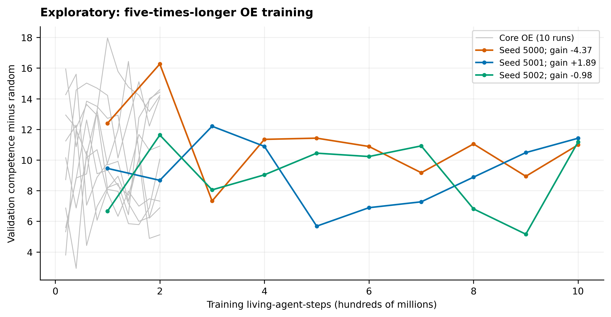

# Part 3: longer OE training

This exploratory experiment was designed on 4 November 2026, after the core results. It evaluated whether a larger training budget improved OE validation performance.

## Design

We trained 3 OE runs for 1,000,000,000 agent-steps, five times the core budget, using the selected OE settings. Each tenth of training was evaluated on 24 validation environments with eight episodes per environment. Evaluation was limited to validation environments.

Hardware: NVIDIA GeForce RTX 4090, 595.91.07, 24564 MiB.

Gain was defined as the mean validation score at 9e8 and 1e9 agent-steps minus the mean at 1e8 and 2e8. The prespecified descriptive rule counted gains above 4.3 points as clear: all runs above the threshold gave "more training helped", none gave "did not help", and other outcomes gave "mixed".

## Results

| Seed | 1e8 | 2e8 | 3e8 | 4e8 | 5e8 | 6e8 | 7e8 | 8e8 | 9e8 | 10e8 | gain | clear gain? |
|---|---|---|---|---|---|---|---|---|---|---|---|---|
| 5000 | 12.40 | 16.27 | 7.33 | 11.35 | 11.43 | 10.88 | 9.17 | 11.05 | 8.94 | 10.99 | -4.37 | no |
| 5001 | 9.45 | 8.67 | 12.20 | 10.89 | 5.68 | 6.89 | 7.27 | 8.88 | 10.48 | 11.42 | +1.89 | no |
| 5002 | 6.66 | 11.63 | 8.05 | 9.03 | 10.45 | 10.23 | 10.92 | 6.81 | 5.16 | 11.18 | -0.98 | no |
| mean | 9.50 | 12.19 | 9.19 | 10.42 | 9.19 | 9.33 | 9.12 | 8.91 | 8.19 | 11.20 | -1.15 | |

**Descriptive result: did not help.** 0 of 3 runs exceeded the 4.3-point threshold. This small experiment does not estimate the size of a possible benefit precisely.

At the core budget of 2e8 agent-steps, mean validation scores were PPO-fixed 27.17; PPO-DR 26.43; ES-DR 25.64; OE 10.61 (10 runs, range 5.12–14.59).
At 2e7 agent-steps, the corresponding scores were PPO-fixed 27.17; PPO-DR 26.44; ES-DR 21.23. PPO and ES were not evaluated at 1e9 agent-steps.

## Threshold sensitivity

The 4.3-point threshold was based on an estimated noise SD of 2.17, assuming independent scores across checkpoints. A post hoc calculation of the same gain statistic on the core OE curves gave mean +0.11, sample SD 5.03 and range -8.38 to +7.04; 4 of 10 gains exceeded ±4.3. The threshold was therefore 0.9 SD of this observed spread.

## Comparison with the core runs

The longer runs restarted training with the same seeds and settings on separate machines. 3 of 3 differed from their core counterpart during the shared training interval.

At 1e8 and 2e8 agent-steps, the core OE means were 10.60 (range 7.85–17.96) and 10.61 (range 5.12–14.59); the longer-run means were 9.50 and 12.19.

## Population during training (mean per tenth, from progress.jsonl)

| Seed | measure | 1/10 | 2/10 | 3/10 | 4/10 | 5/10 | 6/10 | 7/10 | 8/10 | 9/10 | 10/10 |
|---|---|---|---|---|---|---|---|---|---|---|---|
| 5000 | agents alive | 20.3 | 20.2 | 20.8 | 21.3 | 20.9 | 20.7 | 20.9 | 20.7 | 20.4 | 20.4 |
| 5000 | floor share of new agents | 0.58 | 0.55 | 0.51 | 0.48 | 0.50 | 0.52 | 0.53 | 0.54 | 0.51 | 0.53 |
| 5001 | agents alive | 20.3 | 19.5 | 19.4 | 20.4 | 20.0 | 21.5 | 22.2 | 22.4 | 22.1 | 21.9 |
| 5001 | floor share of new agents | 0.57 | 0.67 | 0.60 | 0.52 | 0.58 | 0.54 | 0.46 | 0.53 | 0.50 | 0.45 |
| 5002 | agents alive | 20.3 | 19.2 | 19.2 | 18.7 | 20.1 | 19.9 | 20.2 | 19.6 | 19.4 | 19.4 |
| 5002 | floor share of new agents | 0.56 | 0.65 | 0.65 | 0.67 | 0.60 | 0.59 | 0.54 | 0.64 | 0.65 | 0.66 |

Training wall time: seed 5000 1.78 h; seed 5001 1.96 h; seed 5002 1.83 h.
