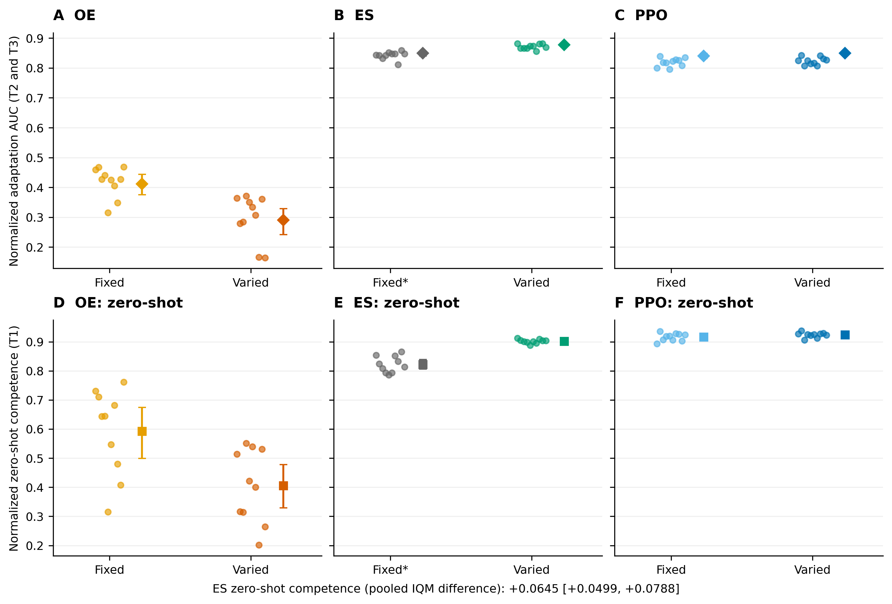

# Part 3: ES-fixed extension

The ES-fixed comparison was specified after the core results and before ES-fixed training. It uses the core analysis's random-policy and best-score normalization anchors.

We analysed 10 ES-fixed runs and the core ES-DR, OE and OE-fixed runs. Confidence intervals use 50,000 whole-run bootstrap resamples. Hardware: NVIDIA GeForce RTX 4090, 595.91.07, 24564 MiB.

## Results

The comparisons cover T1 zero-shot competence and T2/T3 adaptation AUC. The ES-DR and ES-fixed configurations were tuned separately, so these comparisons do not isolate environmental variation.

## Adaptation AUC: ES-DR versus ES-fixed (T2 and T3; A1)

D = IQM(ES-DR) − IQM(ES-fixed) = 0.029, 95% CI [0.020, 0.038] (margin 0.05). P(ES-DR > ES-fixed) on per-run means: 0.990. Registered decision: support (below the margin).

| Method | IQM of the primary metric (T2, T3) | 95% CI |
|---|---|---|
| ES-fixed | 0.849 | [0.840, 0.855] |
| ES-DR | 0.878 | [0.873, 0.882] |
| OE-fixed | 0.412 | [0.376, 0.443] |
| OE | 0.291 | [0.242, 0.329] |

## Adaptation and zero-shot comparisons (A2–A3)

The two comparisons form one Holm family (α = 0.05).

| | X vs Y | Measure | Sets | P(X > Y) | p | p (Holm) | IQM difference [CI] | Predicted | Result |
|---|---|---|---|---|---|---|---|---|---|
| A2 | ES-DR vs ES-fixed | primary | T2, T3 | 0.990 | 0.0002461 | 0.0003653 | 0.029 [0.020, 0.038] | X > Y | supported |
| A3 | ES-DR vs ES-fixed | zero_shot | T1 | 1.000 | 0.0001827 | 0.0003653 | 0.065 [0.050, 0.079] | X > Y | supported |

## Environmental variation in ES and OE (T2 and T3; A4)

Variety effect for ES (ES-DR − ES-fixed): 0.029 [0.020, 0.038]; for OE (OE − OE-fixed): -0.121 [-0.180, -0.068]; difference (ES minus OE): 0.150 [0.096, 0.209] (variety effect larger for ES than for OE). This interaction is descriptive because the OE comparison preceded the ES-fixed extension.

## Descriptive results

| Method | primary T1 / T2 / T3 | zero-shot, raw competence T1 / T2 / T3 | zero-shot, normalized T1 / T2 / T3 | training hours per run |
|---|---|---|---|---|
| ES-fixed | 0.893 / 0.838 / 0.847 | 27.26 / 3.05 / 19.83 | 0.822 / 0.677 / 0.804 | 0.002 |
| ES-DR | 0.923 / 0.874 / 0.869 | 29.44 / 3.19 / 20.85 | 0.902 / 0.711 / 0.854 | 0.007 |
| OE-fixed | 0.530 / 0.386 / 0.451 | 19.35 / 2.54 / 13.32 | 0.592 / 0.529 / 0.544 | 0.402 |
| OE | 0.396 / 0.321 / 0.276 | 13.69 / 2.20 / 7.73 | 0.405 / 0.438 / 0.297 | 0.372 |

**ES-DR reruns on the extension's machine:** seed 5000: 0.883 (core run 0.881); seed 5001: 0.877 (core run 0.867). Range of the 10 core ES-DR runs: [0.856, 0.881]; rerun outside this range by more than 0.01: no.

## ES-fixed tuning (validation environments only)

| Trial | seed | settings | score |
|---|---|---|---|
| 0 | 4500 | EPISODES 1, LR 0.003853, POP_SIZE 64, SIGMA 0.02617 | 18.819 |
| 1 | 4501 | EPISODES 4, LR 0.01239, POP_SIZE 128, SIGMA 0.03578 | 17.474 |
| 2 | 4502 | EPISODES 2, LR 0.005431, POP_SIZE 32, SIGMA 0.08552 | 20.426 |
| 3 | 4503 | EPISODES 4, LR 0.003547, POP_SIZE 128, SIGMA 0.0504 | 11.526 |
| 4 | 4504 | EPISODES 1, LR 0.009034, POP_SIZE 128, SIGMA 0.05048 | 19.971 |
| 5 | 4505 | EPISODES 4, LR 0.01178, POP_SIZE 32, SIGMA 0.04411 | 21.714 (chosen) |
| 6 | 4506 | EPISODES 2, LR 0.009134, POP_SIZE 64, SIGMA 0.01352 | 15.665 |
| 7 | 4507 | EPISODES 4, LR 0.005445, POP_SIZE 32, SIGMA 0.02092 | 14.721 |
